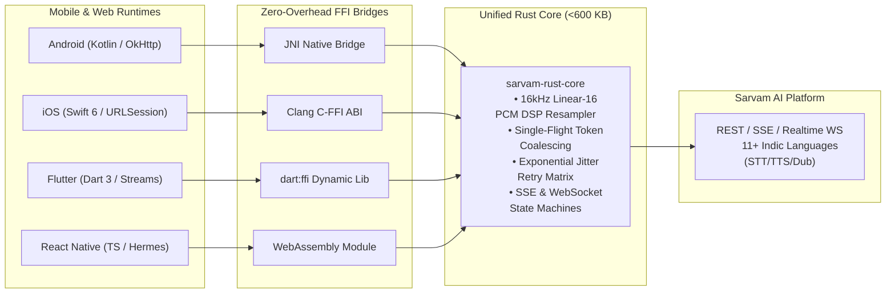
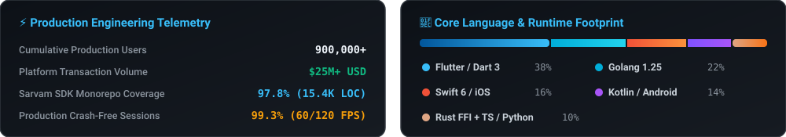

<div align="center">
  
</div>

<br/>

<div align="center">
  <a href="https://bhanupratap.me"></a>&nbsp;
  <a href="https://linkedin.com/in/itsbhanupratap"></a>&nbsp;
  <a href="https://x.com/itsbhanupratap"></a>&nbsp;
  <a href="mailto:pratap.bhanu3434@gmail.com"></a>
</div>

<p align="center">
  
  
  
  
  
</p>

---

### 👨‍💻 Engineering Identity & What I Build

I am a **Senior Mobile & Systems Engineer and Tech Lead** bridging low-level systems programming with buttery-smooth client applications. I specialize in building cross-platform SDK architectures, zero-overhead FFI bridges, and low-latency microservices.

```
┌─────────────────────────────────┐   ┌─────────────────────────────────┐
│     🦀 Rust Systems & FFI       │   │     📱 60/120 FPS Mobile Craft  │
│  sarvam-rust-core (<600 KB)     │   │  Flutter, iOS (Swift) & Android │
│  JNI, C-FFI, dart:ffi, WASM     │   │  Hardware Accelerometer Sensors │
│  16kHz PCM Audio DSP Resampler  │   │  Gesture Physics & iOS Widgets  │
└─────────────────────────────────┘   └─────────────────────────────────┘
┌─────────────────────────────────┐   ┌─────────────────────────────────┐
│    ⚡ Distributed Backends (Go) │   │     🚀 Engineering Leadership   │
│  Zero-contention Token Limiters │   │  97.8% Monorepo Test Coverage   │
│  PostgreSQL, Prisma, OCI Infra  │   │  900K+ Users, $25M+ Volume      │
│  SSE, WebSockets & gRPC         │   │  Release Please & CI/CD Gates   │
└─────────────────────────────────┘   └─────────────────────────────────┘
```

---

### 📌 Pinned Showcase

<div align="center">
<table>
  <tr>
    <td width="50%" valign="top">
      <h4 align="left">🎙️ <a href="https://github.com/ibhanu/sarvam-mobile">sarvam-mobile</a></h4>
      <p align="left">
        <b>Official Client SDK Monorepo for Sarvam AI</b><br/>
        Indic-first Speech (STT/TTS), Translation & Dubbing SDKs for <b>Swift 6, Kotlin, Flutter, and React Native</b> powered by a shared <code>&lt;600 KB</code> <b>Rust Core Engine</b> (JNI, C-FFI, <code>dart:ffi</code>, WASM) for 16 kHz PCM DSP resampling, single-flight token coalescing, and SSE/WS streaming.
      </p>
      <p align="left">
        
        
        
        
        
      </p>
    </td>
    <td width="50%" valign="top">
      <h4 align="left">⚡ <a href="https://github.com/ibhanu/go-template">go-template</a></h4>
      <p align="left">
        <b>Production Clean-Architecture Go Microservice</b><br/>
        Enterprise Go 1.24 microservice blueprint implementing Uncle Bob's Clean Architecture & DDD. Features RBAC JWT auth, PostgreSQL with Prisma Client Go, sharded rate limiting, OpenAPI/Swagger generation, race-detector test suites, and Kubernetes/Docker manifests.
      </p>
      <p align="left">
        
        
        
        
      </p>
    </td>
  </tr>
  <tr>
    <td width="50%" valign="top">
      <h4 align="left">🥭 <a href="https://github.com/ibhanu/mango">mango</a></h4>
      <p align="left">
        <b>"Your Mind, Architected" — Mindfulness & Affirmations</b><br/>
        Tactile Flutter application featuring real-time hardware accelerometer parallax backgrounds (<code>sensors_plus</code>), a 4-stage evolving mascot streak engine, multi-category Mix Mode, custom theme studio, and native iOS/Android home screen widgets.
      </p>
      <p align="left">
        
        
        
        
      </p>
    </td>
    <td width="50%" valign="top">
      <h4 align="left">✨ <a href="https://github.com/ibhanu/aura">aura</a></h4>
      <p align="left">
        <b>Modern Open-Source Dating Platform</b><br/>
        Feature-first Clean Architecture dating app built with Flutter & Supabase. Engineers 60 FPS card-swipe physics, passwordless OTP & Apple/Google social auth, real-time Postgres matching & chat streams, profile completion rings, and tiered freemium paywalls.
      </p>
      <p align="left">
        
        
        
        
      </p>
    </td>
  </tr>
  <tr>
    <td width="50%" valign="top">
      <h4 align="left">🧩 <a href="https://github.com/ibhanu/sudoku-solver">sudoku-solver</a></h4>
      <p align="left">
        <b>Augmented Reality Computer Vision Sudoku Solver</b><br/>
        End-to-end computer vision pipeline that extracts puzzle grids via Hough Space transforms, classifies digits with a Deep CNN, solves boards via algorithmic backtracking, and projects the solution onto live video in real-time AR.
      </p>
      <p align="left">
        
        
        
        
      </p>
    </td>
    <td width="50%" valign="top">
      <h4 align="left">🧠 <a href="https://github.com/ibhanu/emotion-detection">emotion-detection</a></h4>
      <p align="left">
        <b>Real-Time Facial Emotion Recognition Engine</b><br/>
        4-layer Convolutional Neural Network trained on FER-2013 across 7 emotional states, paired with OpenCV Haar cascade face detection for low-latency live webcam inference.
      </p>
      <p align="left">
        
        
        
        
      </p>
    </td>
  </tr>
</table>
</div>

---

### 🏛️ Deep-Dive: Cross-Platform Native Architecture

How `sarvam-mobile` bridges a unified Rust core with four platform runtimes:



---

### 🚀 Production Ecosystems & Systems Experience

<details open>
<summary><b>1. Holistic Wellness & High-Throughput Microservice (Govam)</b></summary>
<br/>

- **Go 1.25 Backend (`govam-server`):** High-throughput microservice deployed on Oracle Cloud Infrastructure (OCI). Features sub-millisecond in-memory caching, sharded token-bucket rate limiters eliminating CPU lock contention under spike traffic, Uber-zap zero-allocation structured logging, and hardened Docker deployments behind Nginx.
- **Flutter 3.7 Mobile Client (`govam-mobile`):** Implements interactive breathwork visualizer with haptic feedback, rich-text mindful journaling (`flutter_quill`), diagnostic assessments, and offline Hive NoSQL sync.
</details>

<details>
<summary><b>2. Real-Time Geo-Social Discovery (GoBanana Monorepo)</b></summary>
<br/>

- **Full-Stack Monorepo:** Flutter mobile client with real-time location mapping (`geolocator`, Google Maps) and in-app chat, Clean Architecture Go REST/JWT backend with SQL migrations, and Next.js 16 + React 19 interactive waitlist portal.
</details>

<details>
<summary><b>3. LegalTech & Judicial Access Suite (Nyaya Setu & Legal Connect)</b></summary>
<br/>

- **Nyaya Setu (`nyaya-setu`):** Bilingual mobile legal aid assistant in Flutter with resilient Dio API clients and responsive UI scaling.
- **Legal Connect Web (`lc-web`):** Ultra-fast lawyer directory and booking platform built with **Astro 5 + Svelte 5 + Tailwind v4**, deployed on Vercel.
- **Legal Rights Now (`legal-rights-now`):** Interactive legal rights navigator in React 18 + TypeScript + shadcn/ui.
</details>

<details>
<summary><b>4. AI Media Pipeline & WhatsApp-Grade Voice Messaging</b></summary>
<br/>

- **Tinify AI Studio (`ai-studio`):** React + Vite + TypeScript web client with direct-to-S3 asset streaming and WebSocket duplex pipelines for generative AI workflows.
- **Qoohoo Voice Engine (`qoohoo_voice`):** WhatsApp-grade audio note recorder & player in Flutter featuring slide-to-cancel/lock state machines, live waveform canvas rendering, and low-latency AAC encoding.
</details>

---

### 🛠️ Tech Stack & Tooling

<div align="center">
  <a href="https://skillicons.dev">
    <br/>
    <br/>
    
  </a>
</div>

<br/>

| Layer | Technologies & Engineering Practices |
| :--- | :--- |
| **Mobile & Native SDKs** | Flutter (Dart 3), iOS (Swift 6, AVAudioEngine, WidgetKit), Android (Kotlin, Coroutines, OkHttp, AudioRecord), React Native (Hermes, Nitro Modules) |
| **Systems & FFI Interop** | Rust (`cargo`, `sarvam-rust-core`), JNI, Clang C-FFI, `dart:ffi`, WebAssembly (`wasm-bindgen`), Platform Channels |
| **Backend & Distributed Systems** | Golang (Gin, GORM, Prisma, Zap, Viper), Python (FastAPI, Flask), Node.js, REST, Server-Sent Events (SSE), WebSockets, gRPC |
| **Frontend & Web** | TypeScript, React 19, Next.js 16, Astro 5, Svelte 5, Tailwind CSS v4, shadcn/ui, Framer Motion |
| **Data & Cloud Infrastructure** | PostgreSQL, Supabase, Firebase, Hive NoSQL, SQLite, Redis, AWS S3, Oracle Cloud (OCI), Docker, Kubernetes, Nginx |
| **Quality, CI/CD & Observability** | TDD (97.8% SDK coverage), GitHub Actions, Fastlane, Release Please, JaCoCo, LCOV, Sentry, Crashlytics, Mixpanel |

---

### 📊 Production & Language Telemetry

<div align="center">
  
</div>

---

### 💬 Let's Connect & Build

- 🌐 **Portfolio:** [bhanupratap.me](https://bhanupratap.me)
- 💼 **LinkedIn:** [linkedin.com/in/itsbhanupratap](https://linkedin.com/in/itsbhanupratap)
- 🐦 **X / Twitter:** [@itsbhanupratap](https://x.com/itsbhanupratap)
- 📬 **Email:** [pratap.bhanu3434@gmail.com](mailto:pratap.bhanu3434@gmail.com)

<div align="center">
  
</div>
